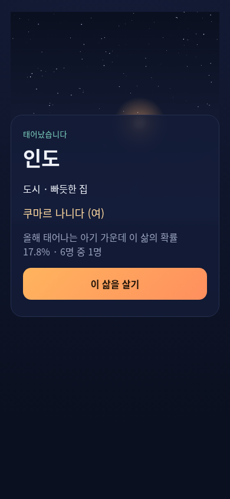
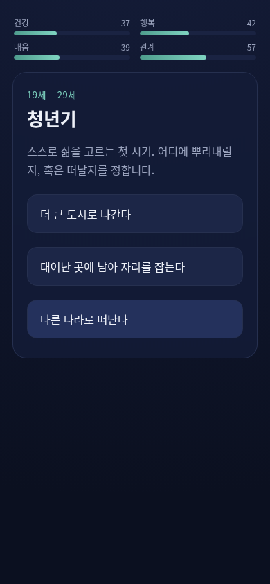
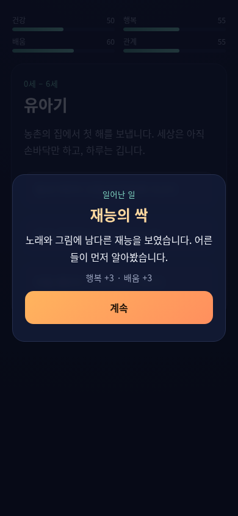
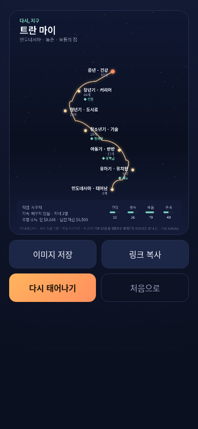

# 다시, 지구

> 올해 지구에서 태어나는 아기 약 1억 3천만 명. 그중 한 명이 당신입니다.

**「다시, 지구」**는 공개 통계로 출생지를 추첨하고, 태어나서 죽을 때까지를 약 3분 동안 살아 보는 **텍스트 인생 시뮬레이션 웹게임**입니다.

**플레이**: https://sigco3111.github.io/dashi-jigu/



## 게임 방법

1. **태어나기** — 올해 출생아 수에 비례해 211개 나라·지역 가운데 한 나라가 뽑힙니다. 아기가 많이 태어나는 나라일수록 자주 나옵니다. 도시인지 농촌인지, 다섯 등급 가운데 몇 번째 살림인지, 이름도 함께 정해집니다.
2. **인생 여덟 구간** — 유아기(0~6세)부터 고령기(75~90세)까지, 구간마다 한 가지를 고릅니다. 학교에 남을지, 일을 시작할지, 다른 나라로 떠날지. 고를 때마다 **건강·행복·배움·관계** 네 스탯이 오르내립니다.
3. **인생 이벤트** — 구간마다 50% 확률로 사건이 일어납니다. 장학금, 첫사랑, 실업, 손주 탄생처럼 기쁜 일과 아픈 일이 나라의 소득 수준, 가정 형편, 내 스탯, 이전 선택에 따라 걸러져 스탯을 움직입니다. 8개 구간에 걸쳐 45종의 사건이 준비돼 있습니다.
4. **죽음과 인생 지도** — 산 나이와 사인, 가족, 직업, 추정 소득이 정산되고, 태어남에서 죽음까지의 궤적을 그린 **인생 지도** 카드 한 장이 나옵니다. 겪은 사건은 ◆ 표시로 궤적에 새겨집니다. 이미지로 저장하거나 링크로 공유할 수 있습니다.
5. **다시 태어나기** — 지난 생애는 이 브라우저의 기록함(지난 생애)에 쌓입니다.





## 화면의 숫자는 어디서 오나요

- 나라별 인구·조출생률·기대수명·1인당 GDP·도시화율·지니계수는 **세계은행 세계개발지표(WDI)** 의 실제 값입니다(2020~2024년 최신치, CC BY 4.0).
- 나라 이름의 한글 표기는 **Unicode CLDR** 을 따릅니다.
- 출생 추첨은 나라별 연간 출생아 수(인구 × 조출생률)에 비례하는 가중 추첨입니다.
- 수명은 **Gompertz 생존 모델**로 추첨합니다. 나라별 기대수명을 중앙값으로 보정하고, 건강 스탯과 가정 형편이 위아래로 움직입니다.
- 인생 이벤트는 시드에서 파생된 별도 난수 스트림으로 뽑습니다. 사건이 하나도 일어나지 않은 삶은 이전 판(R1)의 공유 링크와 정확히 같은 경로를 걷습니다.
- 소득과 재산은 나라별 1인당 GDP와 지니계수 분포로 추정한 값이며, 화면에 **(추정)** 으로 표시합니다.
- 이름 목록, 사건 문장, 결과 카드 디자인은 이 게임을 위해 새로 만든 것입니다.

## 기술

빌드 과정이 없는 순수 정적 사이트입니다. GitHub Pages에 그대로 올라갑니다.

```
index.html          앱 껍데기
css/style.css       밤하늘·도시 불빛 테마
js/engine.js        시드 결정론 엔진 (mulberry32, Gompertz, 가중 추첨)
js/app.js           화면 전환, HUD, 탄생 연출, 인생 지도 카드(canvas)
data/countries.js   211개국 WDI 데이터 (2026-10-17 생성)
data/content.js     이름 목록·인생 구간·45종 인생 이벤트·사인·직업 (자체 작성)
```

- **시드 결정론**: 같은 시드 + 같은 선택 = 같은 인생. 공유 링크는 `#s=시드-선택` 형태로 서버 없이 같은 삶을 다시 계산합니다.
- **저장**: 지난 생애는 localStorage에만 남습니다. 서버에는 아무것도 저장되지 않습니다.
- **인생 지도**: canvas로 그려 PNG로 저장합니다.



## 로드맵

이 저장소는 **시험판(R2)** 입니다.

- R1 (2026-10-17): 출생 추첨, 인생 여덟 구간, 인생 지도 카드, 공유 링크, 지난 생애 기록함.
- R2 (2026-10-17): **인생 이벤트 시스템** — 구간당 50% 확률, 45종 사건, 국가·소득·지표·이전 선택 조건, 스탯·수명 반영, 인생 지도 ◆ 표시.

이후 라운드 계획: 결과 카드 공유 팩(OG 태그·공유 문구), 지난 생애 컬렉션 화면, 삶의 리포트(상위 몇 % 삶), 탄생 지구본 연출 등 비주얼 고도화, '또 다른 나' 평행 인생 비교, 이벤트 연쇄, 도전과 업적, 시대 모드(1900/2100), 한국 상세 모드, 사운드, 다국어.

## 저작권 메모

끼리테스트의 「다음 생」(life.kkiritest.com)에서 영감을 받은 오마주입니다. 게임 아이디어와 공개 데이터만 참고했고, 문장·이름 목록·디자인·브랜드는 전부 새로 만들었습니다. 데이터 출처(World Bank, CC BY 4.0)는 게임 안과 결과 카드에 표기합니다.
